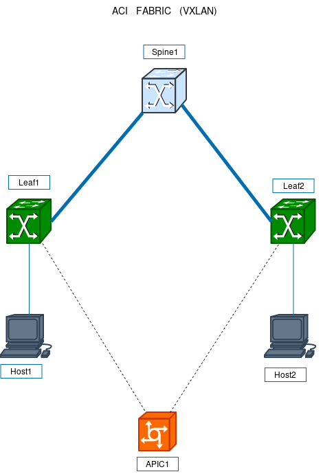

# ACI-Inspired VXLAN Lab — Network Automation with Python

Hands-on datacenter networking lab exploring VXLAN overlays, Linux-based forwarding, policy-driven segmentation, and remote infrastructure automation.

> [!IMPORTANT]
> This project is **not a Cisco ACI emulator**. It does not run Cisco APIC, Cisco ACI software, or physical ACI switches. It uses Linux networking and Python/SSH workflows to study selected architectural ideas associated with modern policy-driven datacenter fabrics.

## Overview

This repository presents a small ACI-inspired spine–leaf lab built around open Linux networking components. The project separates the network into an IP underlay, a VXLAN overlay, endpoint segments, and policy controls. A Python-based automation workflow is intended to coordinate configuration remotely over SSH.

The lab is designed as a learning and portfolio project. Its purpose is to demonstrate how overlay networking, segmentation, automation, and structured troubleshooting fit together—not to reproduce the Cisco ACI control plane or claim hands-on APIC implementation.

The current design includes:

- One conceptual spine node
- Two conceptual leaf nodes acting as VXLAN tunnel endpoints (VTEPs)
- A web endpoint and a database endpoint
- Linux routing and VXLAN data-plane functions
- `iptables`-based policy enforcement
- Python orchestration and SSH-based remote execution as the automation model

No BGP EVPN control plane is implemented or claimed in this repository.

## Project Goals

- Build a clear mental model of underlay and overlay separation.
- Explore Layer 2 extension over an IP transport using VXLAN.
- Apply policy-based segmentation between application tiers.
- Use Linux tools to configure and inspect forwarding behavior.
- Organize repeatable infrastructure changes through Python and SSH.
- Practice validation from physical/interface state through policy and application reachability.
- Connect foundational lab work with datacenter and NetDevOps operating models.

## Architecture

### Underlay

The underlay provides IP reachability between the Linux nodes that participate in the fabric. It is the transport network on which VXLAN packets travel.

The repository currently identifies the underlay with `10.0.x.x` addressing. Before troubleshooting the overlay, every VTEP must be able to reach its remote tunnel endpoint through this IP network.

### Overlay

VXLAN encapsulates Layer 2 traffic in UDP across the Layer 3 underlay. In the lab model, the leaf nodes act as VTEPs and connect endpoint-facing segments through a VXLAN Network Identifier (VNI).

The checked-in variables currently document:

| Variable | Current value | Purpose |
|---|---:|---|
| `WEB_IP` | `10.0.1.10` | Web endpoint address |
| `DB_IP` | `10.0.2.10` | Database endpoint address |
| `VXLAN_VNI` | `10` | VXLAN segment identifier |
| `SUBNET` | `192.168.100.0/24` | Documented overlay subnet |

These values are configuration inputs, not proof that a topology is already running.

### Policy and Security

The security model is inspired by the intent of application-tier policy: permit only the traffic required between the web and database segments and deny unauthorized inter-segment access.

Linux `iptables` rules provide the enforcement mechanism in this lab. They are conceptually similar to contract-based segmentation, but they are **not Cisco ACI contracts** and are not programmed by APIC.

The intended policy behavior is:

- Allow explicitly required web-to-database communication.
- Deny unauthorized inter-segment traffic.
- Reduce lateral movement between workloads.
- Validate both permitted and denied flows.

### Automation

The automation model uses a control node to coordinate infrastructure changes through Python and SSH. The documented workflow covers:

- Connecting to remote Linux nodes.
- Applying endpoint and VXLAN configuration.
- Installing firewall policy.
- Collecting command results for validation and troubleshooting.

This is host-level automation over SSH. It is not APIC API automation and does not interact with a Cisco ACI fabric.

## Topology



> The diagram is conceptual. The `APIC1` label represents the idea of centralized control only; no Cisco APIC appliance or emulator is included. The implemented automation model is Python-based remote execution against Linux nodes.

```text
                         +---------+
                         | Spine 1 |
                         +----+----+
                              |
                   +----------+----------+
                   |                     |
              +----+----+           +----+----+
              | Leaf 1  |           | Leaf 2  |
              |  VTEP   |===========|  VTEP   |
              +----+----+   VXLAN   +----+----+
                   |                     |
              +----+----+           +----+----+
              |  Web    |           |   DB    |
              |Endpoint |           |Endpoint |
              +---------+           +---------+

              Python control workflow over SSH
```

The solid path represents the underlay transport. The logical VXLAN tunnel connects the VTEPs across that transport. Endpoint policy is enforced with Linux firewall rules.

## Repository Structure

```text
aci-vxlan-lab/
├── configs/
│   └── variables.env          # Documented lab variables
├── diagrams/
│   └── aci-topology.png       # Conceptual topology diagram
├── notes/
│   └── vxlan.md               # VXLAN concept notes
├── scripts/                   # Automation entry in the repository
└── README.md
```

> [!NOTE]
> In the current `main` branch, `scripts/` is stored as a Git link, but the repository does not include a `.gitmodules` mapping. As a result, a fresh clone does not populate executable Python files. Restore the scripts as normal tracked files—or configure a valid submodule—before presenting the automation as directly reproducible.

## Technologies Used

- **Linux networking** — interfaces, addressing, routing, and forwarding
- **`iproute2`** — link, route, neighbor, and VXLAN inspection
- **VXLAN** — Layer 2 overlay transport over an IP underlay
- **Linux bridge/FDB concepts** — endpoint attachment and MAC forwarding
- **`iptables`** — traffic filtering and policy-based segmentation
- **Python** — orchestration model for repeatable configuration
- **SSH** — remote command execution against Linux nodes
- **Git/GitHub** — version control and technical documentation

## Automation Workflow

```text
Review variables and intended state
                ↓
Verify SSH access and underlay reachability
                ↓
Configure endpoint-facing Linux networking
                ↓
Create VXLAN interfaces and attach the overlay
                ↓
Apply segmentation and firewall policy
                ↓
Validate interfaces, forwarding, policy, and traffic
                ↓
Record failures and troubleshoot from underlay upward
```

For production-quality automation, each action should be idempotent, return a clear result, stop safely on errors, and produce logs without exposing credentials.

## Manual vs Automated Elements

| Area | Manual learning path | Automation target |
|---|---|---|
| Underlay | Assign addressing and confirm node-to-node IP reachability | Pre-check reachability before overlay changes |
| VXLAN | Create and inspect VTEP/VXLAN interfaces | Apply repeatable overlay configuration |
| Endpoints | Configure endpoint addresses and routes | Push host configuration remotely |
| Security | Build and inspect `iptables` rules | Apply a consistent policy set |
| Validation | Run interface, route, FDB, packet, and reachability checks | Collect results and report success or failure |
| Troubleshooting | Isolate the fault layer interactively | Surface failed pre-checks and command errors |

The manual path is essential for understanding the data plane. Automation should reproduce a known-good design; it should not hide how the network works.

## Validation and Troubleshooting

Troubleshoot in layers. Do not begin with firewall changes if the underlay is not healthy.

### 1. Underlay reachability

Confirm interface state, addressing, routes, and VTEP-to-VTEP reachability:

```bash
ip -br address
ip route show
ip neighbor show
ping <remote-vtep-ip>
```

Expected result: the remote VTEP address is reachable without depending on the VXLAN overlay.

### 2. VXLAN interface state

Inspect the VXLAN device and its detailed attributes:

```bash
ip link show type vxlan
ip -d link show type vxlan
```

Check the VNI, local VTEP address, remote or learning mode, destination UDP port, and operational state.

### 3. Bridge and forwarding state

If the design uses a Linux bridge, verify port membership and learned MAC addresses:

```bash
bridge link show
bridge fdb show
```

Expected result: endpoint and remote MAC information appears on the correct bridge/VXLAN ports after traffic is generated.

### 4. Encapsulation on the wire

Capture VXLAN traffic on the underlay-facing interface:

```bash
tcpdump -ni <underlay-interface> udp port 4789
```

Expected result: VXLAN UDP packets appear while endpoints communicate. If endpoint traffic exists but no UDP/4789 packets leave the VTEP, inspect VXLAN and bridge configuration.

### 5. Policy behavior

Inspect the active rules and counters:

```bash
iptables -S
iptables -L -n -v
```

Test both sides of the policy:

- A permitted flow should succeed on the intended port.
- A denied flow should fail.
- Relevant rule counters should change during each test.

### 6. Automation and SSH

Before remote execution, confirm authentication, privilege requirements, and target identity. Automation failures commonly come from unreachable hosts, missing privileges, incorrect interface names, or commands that assume state already exists.

### Common Errors

- Troubleshooting the overlay before confirming underlay reachability.
- Reusing the same VNI with inconsistent bridge or subnet configuration.
- Binding the VXLAN device to the wrong local address or interface.
- Forgetting to enable forwarding where routing is required.
- Applying firewall rules before defining and testing the intended traffic matrix.
- Treating successful SSH login as proof that network configuration completed correctly.
- Assuming an empty or unresolved `scripts/` entry contains runnable automation.
- Describing the lab as Cisco ACI or EVPN when neither control plane is implemented.

## Real-World Relevance

This lab develops transferable foundations used in modern datacenter and NetDevOps environments:

- Separating an IP underlay from an overlay data plane
- Understanding VTEP roles and VXLAN encapsulation
- Designing workload segmentation around application intent
- Applying repeatable changes through remote automation
- Validating allowed and denied traffic, not only basic reachability
- Troubleshooting from transport to overlay to policy

These concepts help prepare for technologies such as Cisco ACI and EVPN/VXLAN fabrics. The project should be understood as foundational practice, not evidence of production ACI, APIC, or EVPN deployment experience.

## Key Learnings

- VXLAN depends on a stable and observable IP underlay.
- Overlay reachability and security policy must be validated separately.
- A spine–leaf diagram is an architectural model; implementation details determine actual forwarding behavior.
- Policy intent becomes useful only when both permitted and denied flows are tested.
- Automation needs pre-checks, error handling, idempotency, and post-change validation.
- Clear technical boundaries make a portfolio project more credible: ACI-inspired is not the same as running Cisco ACI.

## How to Run

The repository is a lab reference and does not currently provide a fully verified, one-command deployment. The following sequence is intentionally generic until the topology definition and automation files are complete and validated.

1. Clone the repository and review the topology diagram, VXLAN notes, and `configs/variables.env`.
2. Prepare isolated Linux lab nodes with administrative access and the required networking tools.
3. Define the real node addresses, interface names, VTEP addresses, endpoint attachment, and SSH access method for your environment.
4. Confirm underlay IP connectivity between the intended VTEPs.
5. Restore and review the Python automation files before executing any remote changes. Do not assume the current `scripts/` Git link is usable in a fresh clone.
6. Apply the VXLAN, endpoint, and firewall configuration manually or through reviewed automation.
7. Validate the lab in order: underlay, VXLAN interface, bridge/FDB state, encapsulation, endpoint reachability, and security policy.
8. Save command output and packet captures as evidence of the healthy state and any fault-recovery exercise.

Exact deployment commands are intentionally omitted because the current repository does not contain enough verified implementation detail to guarantee them across environments.

## Roadmap

- [ ] Restore `scripts/` as tracked Python files or configure it as a valid Git submodule.
- [ ] Add a requirements file and document supported Python and Linux versions.
- [ ] Add a reproducible topology definition for the lab environment.
- [ ] Replace environment-specific values with validated inventory/configuration inputs.
- [ ] Add secure credential handling; do not store passwords or private keys in the repository.
- [ ] Add idempotent configuration and rollback behavior.
- [ ] Add structured logging and actionable error messages.
- [ ] Add automated pre-change and post-change validation.
- [ ] Document an explicit application traffic matrix and associated firewall rules.
- [ ] Add sanitized sample outputs and packet-capture evidence.
- [ ] Add controlled failure scenarios for underlay, VXLAN, and policy troubleshooting.
- [ ] Explore REST/API-driven automation without representing it as Cisco APIC integration unless a real APIC environment is used.
- [ ] Evaluate EVPN as a future control-plane extension; keep it outside the current feature set until implemented and validated.

## Author

**Jaime Rosero Mesa**  
Network Engineer | Routing, Datacenter & Network Automation

GitHub: [NetworkJR7](https://github.com/NetworkJR7)

---

This repository documents a learning lab. It does not represent a production deployment or affiliation with Cisco.
